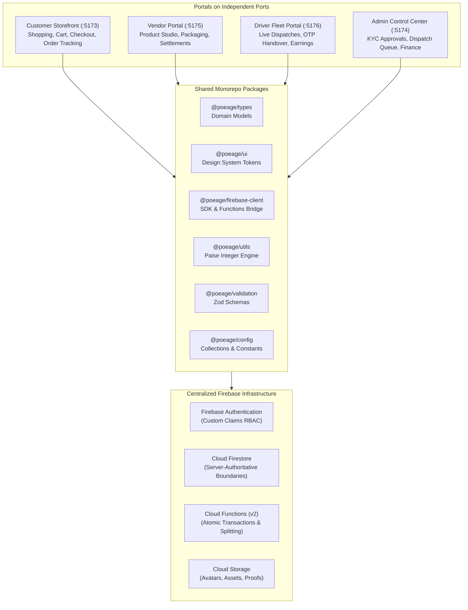
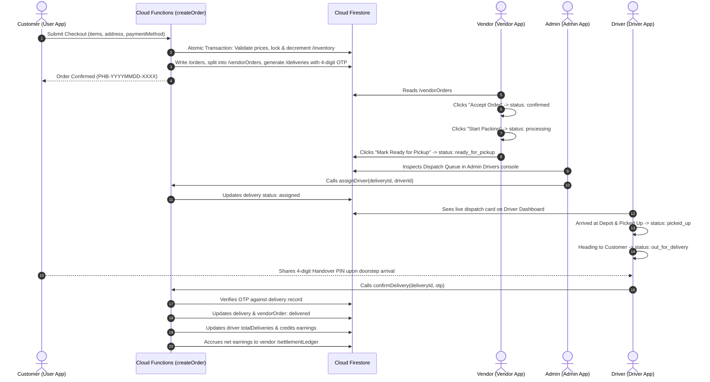

# POEAGE HUB — Enterprise Architecture Documentation

> **Version**: 1.0.0  
> **Status**: Production Architecture  
> **Target Cloud**: Firebase (GCP) & Distributed React Edge  

---

## 1. Executive Summary & Ecosystem Overview

**POEAGE HUB** is a high-performance, multi-vendor e-commerce and logistics marketplace engineered to deliver consumer shopping, merchant store operations, courier dispatching, and administrative marketplace control within a unified monorepo.

The platform coordinates **four role-tailored frontend applications** powered by a single centralized Firebase backend:

---

## 2. Core Architectural Principles

### 2.1. Strict Server-Authoritative Boundaries
* **Client Trust Zero**: Frontend applications NEVER write master financial totals, compute platform commissions, modify inventory counts, or finalize delivery completion.
* **Paise Currency Standard**: Floating-point currency calculations are strictly prohibited. All monetary quantities across frontend stores, database schemas, and Cloud Functions are stored as 64-bit safe integers representing **paise** ($1\text{ INR} = 100\text{ paise}$).
* **Multi-Vendor Sub-Order Partitioning**: When a customer checks out a cart containing items from multiple sellers, an atomic transaction produces one master `/orders/{orderId}` and splits items into isolated `/vendorOrders/{vendorOrderId}` sub-orders. Each merchant accesses only their specific sub-order.

### 2.2. Role-Based Access Control (RBAC) Architecture
Authority is enforced at two distinct enforcement planes:
1. **Application Layer**: Frontend route guards (`ProtectedRoute`, `AdminGuard`, `VendorGuard`, `DriverGuard`) intercept unauthorized UI access.
2. **Database Boundary Layer**: `firestore.rules` and `storage.rules` validate cryptographically signed Firebase Auth tokens (`request.auth.token.roles`). Even if client-side code is tampered with, malicious requests are rejected at the database perimeter.

---

## 3. Order Lifecycle & Dispatch State Machine

---

## 4. Shared Packages Specification

| Package | Purpose | Key Exports |
| :--- | :--- | :--- |
| `@poeage/types` | SDK-agnostic domain models | `UserProfile`, `Product`, `Vendor`, `Driver`, `Order`, `Delivery`, `CartItem`, `Address` |
| `@poeage/ui` | Tailwind component tokens | `Button`, `Input`, `Card`, `Badge`, `Spinner`, `cn` |
| `@poeage/firebase-client` | Client Firebase modular SDK initialization | `db`, `auth`, `storage`, `callFunction`, Firestore subscription helpers |
| `@poeage/utils` | Financial calculations & formatters | `formatMoney`, `formatMoneyCompact`, `rupeesToPaise`, `calculateCommission` |
| `@poeage/validation` | Zod validation boundary schemas | `loginSchema`, `registerSchema`, `addressSchema`, `productSchema`, `couponSchema` |
| `@poeage/config` | Platform configurations & constants | `APP_CONFIG`, `COLLECTION` mappings, status enums |

---

## 5. Security & Isolation Matrix

| Actor Role | Product Access | Order Access | Financial Access | Delivery Access |
| :--- | :--- | :--- | :--- | :--- |
| **Customer** | Read published catalog | Read own master orders | Read personal cart & order receipt | View live timeline & own 4-digit handover PIN |
| **Vendor** | CRUD own store SKUs | Read own assigned `/vendorOrders` | Read own settlement ledger & pending balance | Read pickup instructions for courier |
| **Driver** | None | None | Read personal wallet & trip earnings | Read assigned delivery route & verify customer OTP |
| **Admin** | Full moderation | Full master order inspection | Full platform GMV & payout release | Global fleet dispatch assignment |
