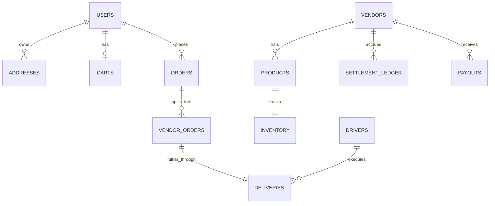

# POEAGE HUB — Database Schema & Data Dictionary

> **Database Engine**: Cloud Firestore (NoSQL Document Store)  
> **Currency Unit**: Integer Paise ($1\text{ INR} = 100\text{ paise}$)  
> **Timestamp Format**: Firestore `Timestamp` (`{ seconds: number, nanoseconds: number }`)

---

## 1. Collection Entity Relationships

---

## 2. Core Collections Specification

### 2.1. `/users/{userId}`
Stores base user profile and associated marketplace permissions.

| Field Name | Type | Description | Security / Rules |
| :--- | :--- | :--- | :--- |
| `id` | `string` | Unique Firebase Auth UID | User or Admin read |
| `email` | `string` | User email address | User or Admin read |
| `displayName` | `string` | Customer / Actor display name | User updateable |
| `phone` | `string?` | 10-digit Indian phone number | User updateable |
| `roles` | `string[]` | Array of roles: `['customer', 'vendor', 'driver', 'admin']` | **Admin only via Cloud Function** |
| `status` | `string` | `'active' \| 'pending' \| 'suspended'` | **Admin only via Cloud Function** |
| `createdAt` | `Timestamp` | Profile creation time | Immutable |
| `updatedAt` | `Timestamp` | Last profile update | Auto-updated |

---

### 2.2. `/products/{productId}`
Published merchant catalog items available for storefront indexing and purchase.

| Field Name | Type | Description |
| :--- | :--- | :--- |
| `id` | `string` | Product document ID |
| `vendorId` | `string` | Owner vendor ID (`vendors/{vendorId}`) |
| `categoryId` | `string` | Foreign key to `categories/{categoryId}` |
| `name` | `string` | Product title |
| `slug` | `string` | SEO-friendly URL slug |
| `description` | `string` | Comprehensive product description |
| `images` | `string[]` | Array of Cloud Storage asset URLs |
| `basePrice` | `number` | Selling price in **paise** |
| `salePrice` | `number?` | Discounted compare MRP in **paise** |
| `costPrice` | `number?` | Vendor production/wholesale cost in **paise** (hidden from customers) |
| `commissionRate`| `number` | Marketplace commission take-rate (e.g., `0.12` = 12%) |
| `gstRate` | `number` | GST tax rate (e.g., `0.18` = 18%) |
| `status` | `string` | `'published' \| 'pending_review' \| 'draft' \| 'rejected'` |
| `metadata` | `object` | `{ totalSold, totalRevenue, averageRating, totalRatings, viewCount }` |

---

### 2.3. `/inventory/{productId}`
Real-time physical stock and reservation tracking.

| Field Name | Type | Description | Security |
| :--- | :--- | :--- | :--- |
| `productId` | `string` | Associated product ID | Read: authenticated |
| `vendorId` | `string` | Associated vendor ID | Read: authenticated |
| `quantity` | `number` | Available physical units in stock | **Write: Cloud Functions / Admin SDK only** |
| `reservedQuantity` | `number` | Units held during active checkout / pending orders | **Write: Cloud Functions / Admin SDK only** |
| `reorderLevel` | `number` | Threshold to trigger vendor replenishment warning | Read: vendor/admin |

---

### 2.4. `/carts/{userId}`
Customer cart state with dual-layer offline & cloud persistence.

| Field Name | Type | Description |
| :--- | :--- | :--- |
| `userId` | `string` | Customer Firebase Auth UID (Doc ID == UID) |
| `items` | `CartItem[]` | Array of `{ productId, variantId?, vendorId, name, imageURL, quantity, unitPrice, totalPrice }` |
| `couponCode` | `string?` | Applied promotional coupon code |
| `couponDiscount` | `number?` | Discount in **paise** |
| `updatedAt` | `Timestamp` | Last modification timestamp |

---

### 2.5. `/orders/{orderId}`
Server-authoritative master purchase record created by `createOrder`.

| Field Name | Type | Description |
| :--- | :--- | :--- |
| `id` | `string` | Unique order ID |
| `customerId` | `string` | Customer Auth UID |
| `orderNumber` | `string` | Human-readable identifier: `PHB-YYYYMMDD-XXXX` |
| `status` | `string` | `'pending_payment' \| 'confirmed' \| 'processing' \| 'shipped' \| 'out_for_delivery' \| 'delivered' \| 'cancelled'` |
| `items` | `OrderItem[]` | Full snapshot of purchased items with prices, GST, and commission calculations |
| `pricing` | `object` | `{ subtotal, couponDiscount, deliveryCharge, gstTotal, grandTotal }` in **paise** |
| `shippingAddress` | `object` | `{ recipientName, phone, line1, landmark?, city, state, pincode, country }` |
| `paymentMethod` | `string` | `'cod' \| 'razorpay_card' \| 'razorpay_upi' \| ...` |
| `vendorOrderIds` | `string[]` | Array of split sub-orders |
| `statusHistory` | `object[]` | Array of `{ status, timestamp, note?, actorId? }` |

---

### 2.6. `/vendorOrders/{vendorOrderId}`
Isolated sub-orders partition for multi-vendor fulfillment.

| Field Name | Type | Description | Access Rules |
| :--- | :--- | :--- | :--- |
| `id` | `string` | Sub-order unique ID | Vendor, Customer, Admin |
| `orderId` | `string` | Master order reference | Vendor, Customer, Admin |
| `vendorId` | `string` | Assigned merchant store ID | **Strict Vendor Isolation** |
| `customerId` | `string` | Purchasing customer ID | Customer, Vendor, Admin |
| `items` | `OrderItem[]` | Items strictly supplied by this vendor | Vendor, Customer, Admin |
| `status` | `string` | `'pending' \| 'confirmed' \| 'processing' \| 'ready_for_pickup' \| 'dispatched' \| 'delivered'` | Updatable by vendor state machine |
| `subtotal` | `number` | Gross vendor line total in **paise** | Vendor, Admin |
| `commissionAmount` | `number` | 12% platform take-rate in **paise** | Vendor, Admin |
| `vendorEarning` | `number` | Net vendor payout (`subtotal - commission`) in **paise** | Vendor, Admin |
| `deliveryId` | `string` | Associated delivery record reference | Vendor, Admin, Driver |

---

### 2.7. `/deliveries/{deliveryId}`
Courier fleet assignment, route details, and customer verification OTP.

| Field Name | Type | Description | Access Rules |
| :--- | :--- | :--- | :--- |
| `id` | `string` | Delivery dispatch document ID | Admin, Driver, Customer |
| `orderId` | `string` | Master order reference | Admin, Driver, Customer |
| `vendorOrderId` | `string` | Sub-order reference | Admin, Driver, Customer |
| `driverId` | `string?` | Assigned driver ID | **Only visible to assigned driver & admin** |
| `status` | `string` | `'pending_assignment' \| 'assigned' \| 'driver_accepted' \| 'picked_up' \| 'out_for_delivery' \| 'delivered'` | Driver / Function update |
| `pickupAddress` | `object` | Vendor depot fulfillment address | Driver, Admin |
| `deliveryAddress` | `object` | Customer destination address & contact phone | Driver, Admin, Customer |
| `verificationOtp` | `string` | **4-digit customer handover PIN** (e.g. `'4821'`) | Customer & Server only; verified upon doorstep arrival |
| `driverEarning` | `number` | Payout credited to driver wallet (default `5000` = ₹50) | Driver, Admin |

---

### 2.8. `/settlementLedger/{id}` & `/payouts/{id}`
Platform accounting records ensuring audit integrity between gross orders and bank disbursements.

| Collection | Key Fields | Purpose |
| :--- | :--- | :--- |
| `settlementLedger` | `vendorId`, `orderId`, `vendorOrderId`, `type: 'order_delivered'`, `subtotal`, `commissionAmount`, `netPayable`, `status: 'accrued' \| 'settled'` | Real-time financial ledger entries posted immediately upon delivery OTP verification |
| `payouts` | `vendorId`, `storeName`, `amount`, `status: 'processed'`, `processedAt`, `processedBy`, `bankDetails` | Record of disbursed funds released by platform administrator |

---

## 3. Composite Indexes (`firestore.indexes.json`)

To support high-throughput multi-vendor queries without indexing latency:
1. `products`: `(status ASC, basePrice ASC)` and `(categoryId ASC, status ASC, basePrice ASC)`
2. `vendorOrders`: `(vendorId ASC, status ASC, createdAt DESC)`
3. `deliveries`: `(driverId ASC, status ASC, createdAt DESC)` and `(status ASC, createdAt DESC)`
4. `settlementLedger`: `(vendorId ASC, status ASC, createdAt ASC)`
